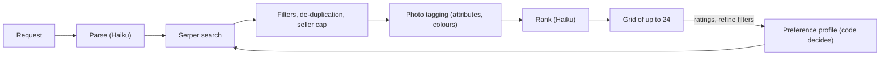
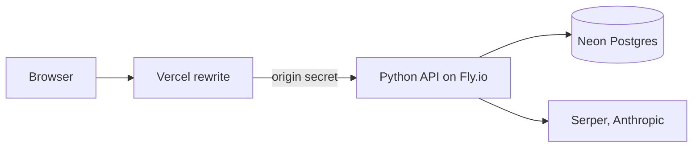

# ShopAI (Room Redesign Agent)

> Describe a product in plain words and get a ranked grid of real listings; rate them, and "Shop Again" returns a fresh batch shaped by what you rated.


**Live tool:** <https://portfolio-site-max-norris.vercel.app/shop> (part of the [portfolio site](https://portfolio-site-max-norris.vercel.app/)). It is a non-commercial portfolio demo: no accounts, no payments, no affiliate links.

This repository is the Python back end, the evaluation harness and the design record. The React page is in the separate portfolio-site repo.

## What it is

Shop Mode (the part that is live):

- You type a request such as "modern couches under $1000". It searches Google Shopping through Serper, filters and ranks the listings with Claude Haiku, and shows a grid.
- You rate each item Love, Like or Dislike, with an optional comment.
- **Shop Again** returns a fresh batch that excludes everything already seen and is shaped by your ratings.
- **Refine search** applies to the next batch: colour, material, shape, style, size, feature, a price minimum and maximum, or free text.
- A Saved list keeps what you loved and liked, and a Share list (email, text, print, CSV) lives in the front end.

**Redesign Mode** (upload a room photo, get a redesign) is planned, not built. The repo holds earlier work toward it: a room-photo pipeline (perception, retrieval, proposal, self-check) and cost-and-latency spikes (`scripts/spike.py`, `scripts/render_spike.py`). Shop Mode came out of that work ([ADR 0012](docs/adr/0012-two-modes-shop-first.md)).

## Project boundary

- **Users:** people browsing for furniture and home goods. Anonymous visitors, no sign-up.
- **Input:** a text request, then ratings and optional refine filters. No photo.
- **Output:** a grid of up to 24 listings per batch with price, seller and a link, plus the preferences the system learned, shown as chips you can delete.
- **Out of scope:** accounts, checkout, payments, affiliate links, price history, Redesign Mode (for now).
- **Data:** listings come from Google Shopping results via Serper. Product photos load from the providers' URLs in the visitor's browser and are never stored or committed. The repo contains only mock data; no real thumbnails and no Serper cache are committed.

## How it works



Shop Again repeats the search with the learned preferences and any refine filters. The model describes each item; code decides what counts as a preference (details in the ADR 0012 amendments).



Stack, checked against `pyproject.toml` and the code: Python 3.11+ with a standard-library `http.server` JSON API (no web framework), `psycopg` for Postgres (SQLite for local tests), Pillow, pydantic, the Anthropic SDK (Claude Haiku for parse, tagging, ranking and the eval judges), Serper for shopping search, Fly.io and Neon for hosting, Vercel and React/TypeScript for the front end (separate repo). Every LLM call goes through `src/app/tracing.py`.

## Results and evidence

Latest full live run: 2026-10-29, 11 of the 12 cases scored (case-07 failed with a connection error and is not scored in this run). The 12 cases and their scripted taste personas are versioned in `evals/shop/cases/`, and the thresholds were locked in their own commit (`evals/shop/thresholds.json`, SHA-256 `c64fe35a51c389603c507ed0a31e4388d08a1e96ee25f2d0bf9288f1fb75d237`, checked by a test). Full report: [`docs/evals/shop-eval-latest-full-run-2026-10-29.md`](docs/evals/shop-eval-latest-full-run-2026-10-29.md).

| Measure | Result | Locked limit |
|---|---|---|
| Checks passed | 21 of 22 | |
| Category match, mean of first batches | 0.992 | >= 0.9 |
| Attributes match, mean of first batches | 0.845 | >= 0.7 |
| Product colour match by photo (one case) | 0.958 | >= 0.7 |
| Price compliance, worst batch | 1.000 | >= 1.0 |
| Shop Again lift, round 2 minus round 1 (mean points) | +8.1 | >= +15.0, **not met** |
| First search, median seconds | 11.1 | <= 30 |
| Shop Again, median seconds | 13.5 | <= 20 |
| Highest pipeline cost of one case (USD) | 0.049 | <= 0.05 |

- The lift target was not met. The +15 point target stands; the result is reported as a miss. Round 2 beat round 1 in 9 of the 11 scored cases.
- The persona judge agreed with itself on 90% of three-way answers when re-run on the same batches (baseline rejudge, [report](docs/evals/shop-eval-baseline-2026-10-26.md)).
- The judges are not yet calibrated against human labels.
- One run of this size cost about $0.21 for Anthropic and 202 Serper credits.
- Tests: 2008 collected by `pytest`.

## Known failures

- **Lift target not met** (above). An earlier full run's [lift diagnosis](docs/evals/shop-lift-diagnosis-2026-10-29.md) found that cases where a learned preference showed up in few of the next items gained little.
- **Attributes are thin.** Material, style and shape come mostly from listing titles, which often leave them out; many listings state no size, so the judge answers "cannot tell" and the check counts that as a miss.
- **The judges are the same model family as the pipeline** (Haiku) and uncalibrated, so blind spots may be shared. The persona is a text description, not a person.
- **Small, noisy sample.** Twelve requests, one live run, live results vary run to run ([`evals/shop/known_instability.md`](evals/shop/known_instability.md)).
- **Clarifying questions were built and set aside.** Questions with option pictures were meant to hide the search wait; they appeared 6 to 10 s into the search and the filters replaced them. The code stays behind `APP_SHOP_CLARIFY`, off by default ([ADR 0015](docs/adr/0015-clarifying-questions-spike.md), [0016](docs/adr/0016-clarify-picture-verification.md), [0017](docs/adr/0017-clarifying-questions-backend.md)).
- **Redesign Mode is not built.**

## Security and cost

- Visitors are anonymous: each gets a random session in an HttpOnly cookie, and only its SHA-256 is stored. Client addresses are stored only as a keyed hash.
- Spending caps per session, per visitor address per day and for everyone per day, plus per-session search limits, bound provider cost. A kill switch turns the API off.
- Visitor data unused for 30 days is deleted.
- An origin secret means only the Vercel proxy can call the API.
- API keys live only in environment variables and are never committed, logged or put in traces; tests enforce this.
- Details: [`docs/deploy.md`](docs/deploy.md), [`docs/api-contract.md`](docs/api-contract.md).

## Quickstart

Requires Python 3.11+ and [uv](https://docs.astral.sh/uv/).

```bash
git clone https://github.com/maxnorris01-bot/room-redesign-agent && cd room-redesign-agent
make install
make test
make eval-fast        # mock mode, free, no key
make shop             # the local app on http://127.0.0.1:8765, fixture results, no network
```

Everything defaults to `APP_LLM_MODE=mock`: `app.llm.get_client` returns a mock client, so nothing touches the network and nothing costs money. The mock produces schema-valid placeholders, so a passing mock run is a plumbing signal, not a quality signal. Only the `-live` targets (and `APP_LLM_MODE=live`) spend money.

## Evals

| Target | What it does | Cost |
|---|---|---|
| `make eval-shop-plan` | Lists cases, personas, thresholds hash and the estimated cost | free |
| `make eval-shop-mock` | The whole harness on fixtures and deterministic judges | free |
| `make eval-shop-replay` | Cases on saved Serper responses, mock model | free |
| `make eval-shop-lint RESULTS=<file>` | Anomalies in a saved live results file | free |
| `make eval-shop-report` | Markdown report from a results file | free |
| `make eval-shop-live EVAL_SHOP_CONFIRM=yes` | The 12 cases against the real APIs; refuses to run in CI or tests | about $0.21 and 200 Serper credits (last full run) |
| `make eval-shop-rejudge EVAL_SHOP_CONFIRM=yes RESULTS=<file>` | Re-runs only the persona judge to measure its self-agreement | about $0.03 |

`make eval-fast`, `eval-standard` and `eval-nightly` run the placeholder room pipeline's evals (mock, free; `-live` variants cost money). Cases and thresholds change only in their own commits; see [`evals/shop/README.md`](evals/shop/README.md).

## Design decisions

- [0002](docs/adr/0002-site-tab-with-python-backend.md): the tool is a site tab backed by a separate Python service.
- [0005](docs/adr/0005-two-stage-shopping-retrieval.md): structured shopping data, and a model that only picks ids, never prices or links.
- [0012](docs/adr/0012-two-modes-shop-first.md): Shop Mode first, Redesign Mode later; the model describes, code decides.
- [0013](docs/adr/0013-shop-mode-invite-only-api.md): a JSON API on Fly behind a Vercel proxy, with caps and an origin secret.
- [0014](docs/adr/0014-anonymous-visitors-instead-of-invites.md): anonymous visitors and spend limits instead of invite codes.
- [0015](docs/adr/0015-clarifying-questions-spike.md) to [0017](docs/adr/0017-clarifying-questions-backend.md): clarifying questions, measured offline first, then set aside.
- Running log: [`docs/working-notes-and-decisions.md`](docs/working-notes-and-decisions.md).

## What's next

- **One decision to revisit:** the +15 point lift target. It was locked before the first measurement (+6.2 at the baseline, +8.1 now), so it is not known whether the target is too high or the pipeline is too weak.
- **One limitation:** the quality judges are unvalidated, so the numbers above are a relative signal.
- **Next test:** Redesign Mode with a room photo, starting with a cost and latency spike before building anything.

## License

MIT. See [LICENSE](LICENSE).
